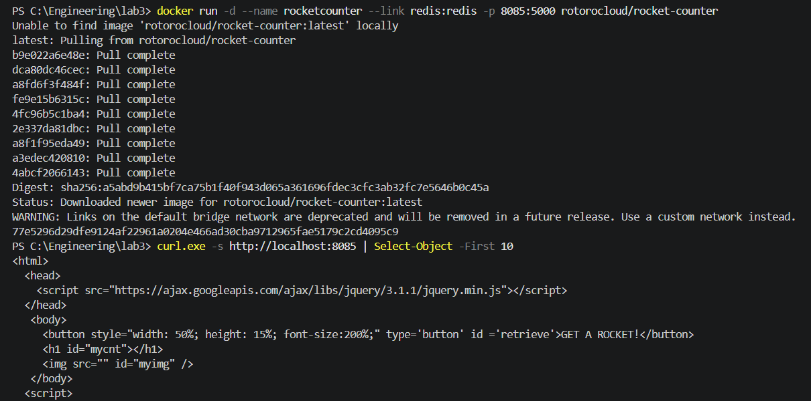
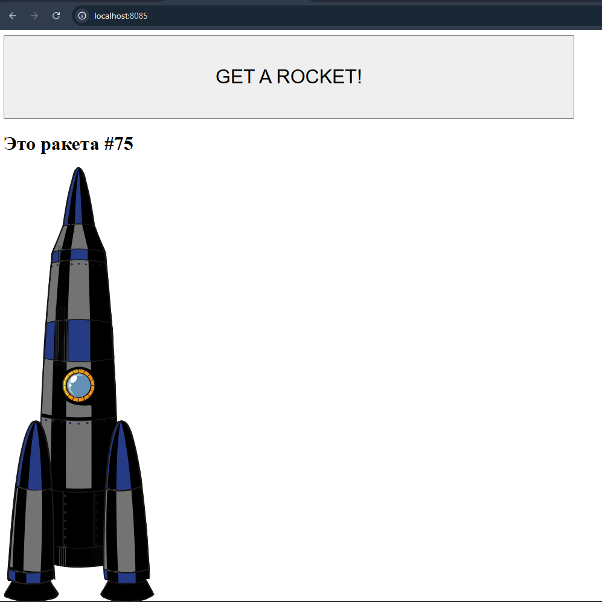
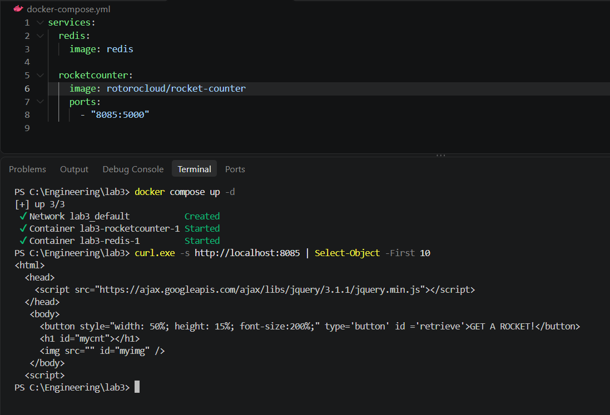
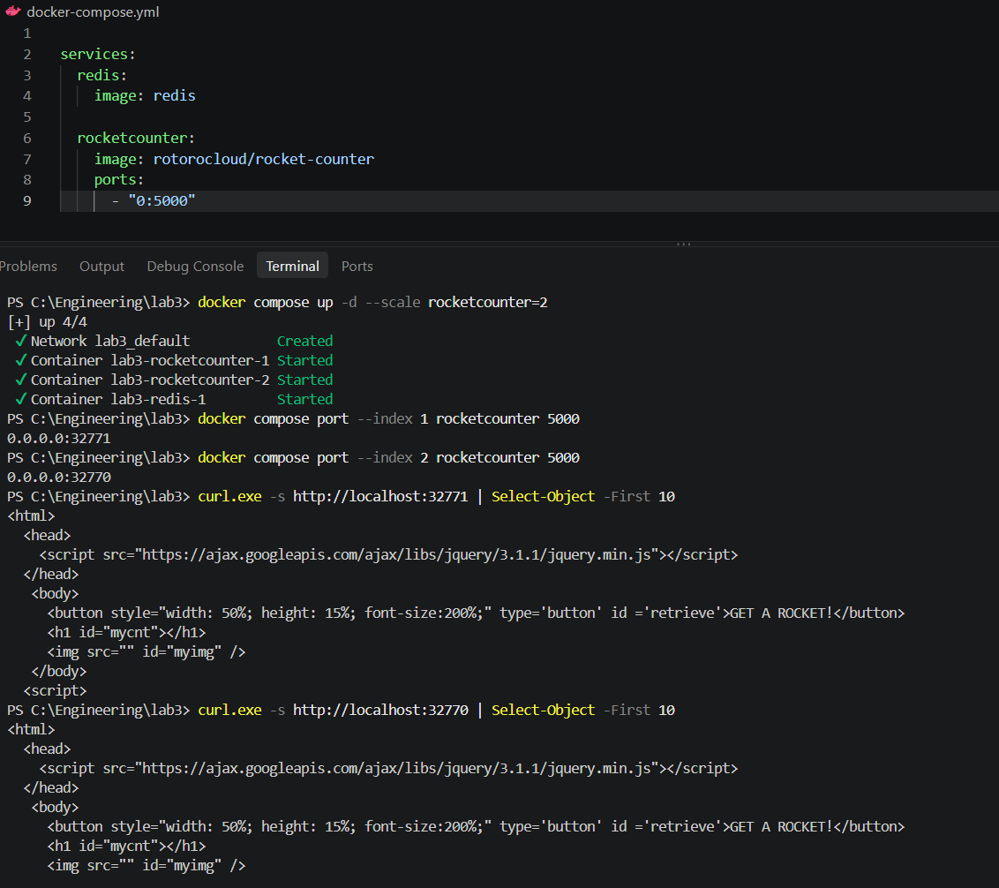
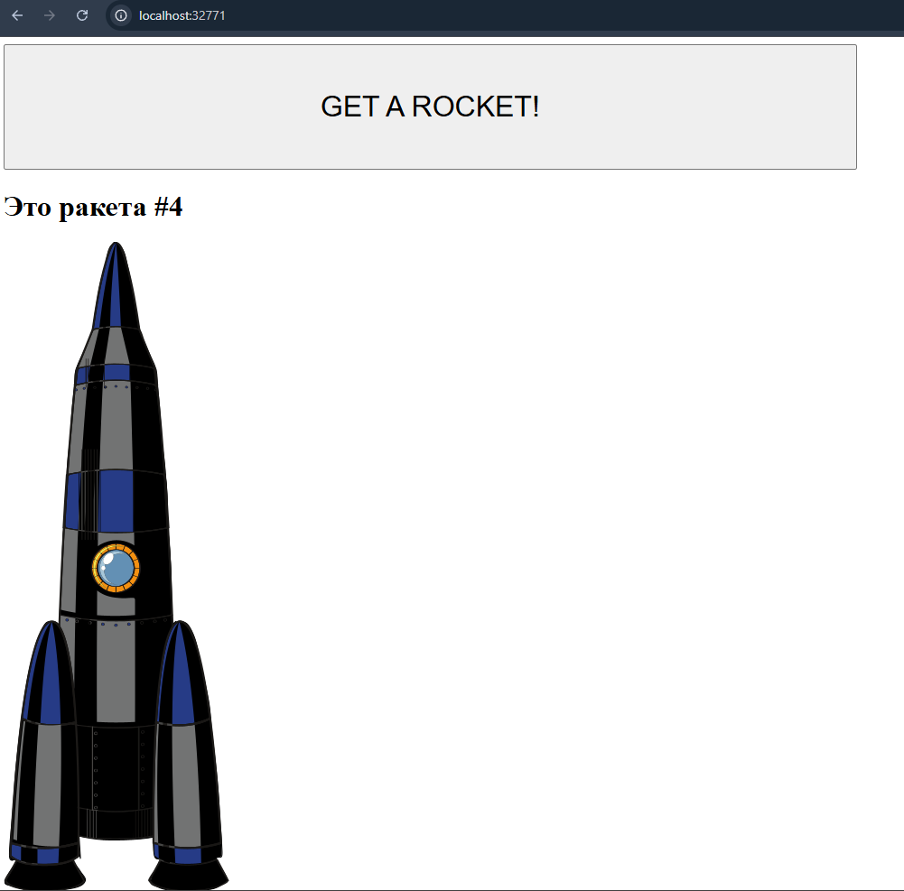
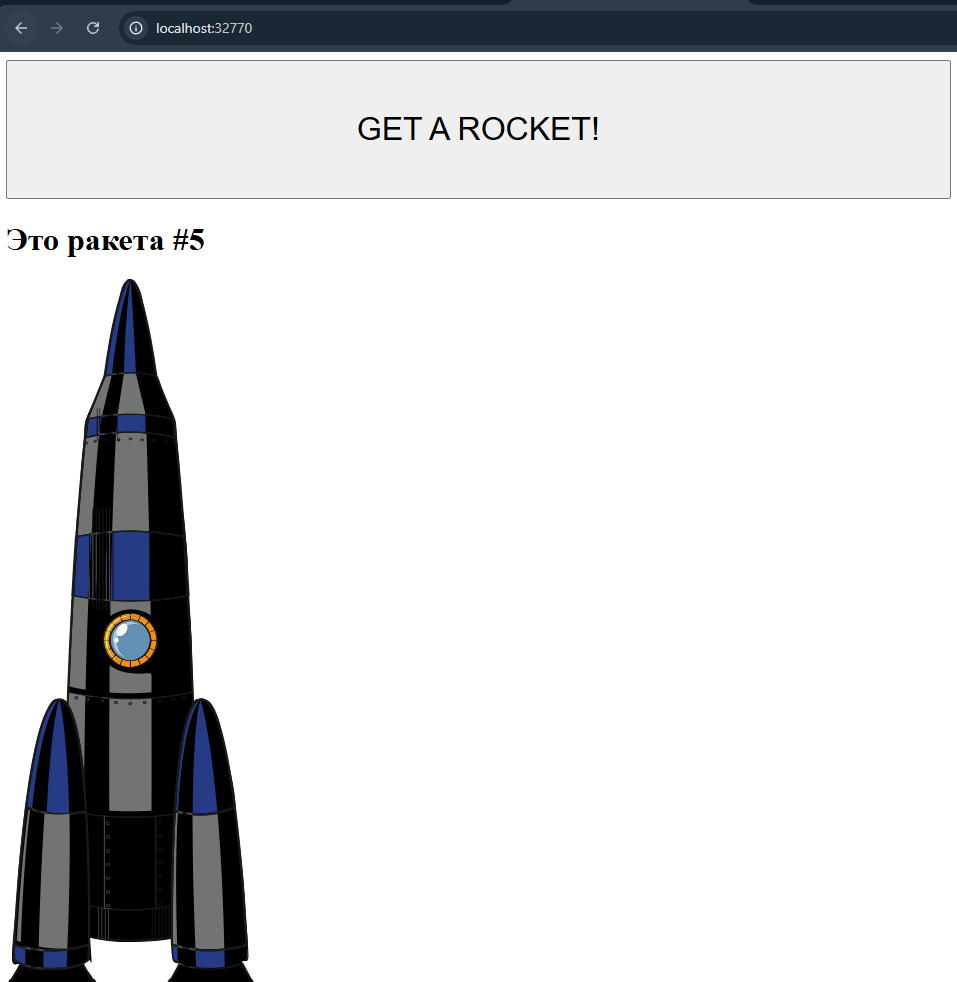
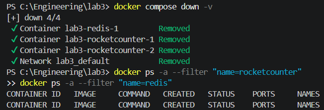

# Отчёт по лабораторной работе №3

## Redis + Rocket Counter. Docker Run, Docker Compose и масштабирование

## 1. Метаданные

| Поле | Значение |
|---|---|
| Образ приложения | `rotorocloud/rocket-counter` |
| Образ базы данных | `redis` |
| Операционная система | `Windows 10/11` |
| Внутренний порт приложения | `5000` |
| Порт хоста при ручном запуске | `8085` |
| Публикация портов при масштабировании | `0:5000` |

---


## 2. Запуск вручную через docker run

### Запуск Redis

Команда:

```powershell
docker run -d --name redis redis
```

Проверка:

```powershell
docker ps
```

### Запуск Rocket Counter

Команда:

```powershell
docker run -d --name rocketcounter --link redis:redis -p 8085:5000 rotorocloud/rocket-counter
```

Проверка контейнеров:

```powershell
docker ps
```

Проверка HTML-страницы:

```powershell
curl.exe -s http://localhost:8085
```



Открытие приложения в браузере:

```powershell
Start-Process "http://localhost:8085"
```



В браузере проверена работа кнопки `GET A ROCKET`. При нажатии значение счётчика увеличивается.

### Удаление контейнеров

```powershell
docker rm -f rocketcounter redis
```

---

## 3. Запуск через Docker Compose

```yaml
services:
  redis:
    image: redis

  rocketcounter:
    image: rotorocloud/rocket-counter
    ports:
      - "8085:5000"
```

Запуск сервисов:

```powershell
docker compose up -d
```

Проверка:

```powershell
docker compose ps
```

Проверка приложения:

```powershell
curl.exe -s http://localhost:8085
```



---

## 4. Масштабирование приложения

Для масштабирования изменена публикация портов:

```yaml
services:
  redis:
    image: redis

  rocketcounter:
    image: rotorocloud/rocket-counter
    ports:
      - "0:5000"
```


Запуск двух экземпляров Rocket Counter:

```powershell
docker compose up -d --scale rocketcounter=2
```

### Получение портов

Первый экземпляр:

```powershell
docker compose port --index 1 rocketcounter 5000
```

Второй экземпляр:

```powershell
docker compose port --index 2 rocketcounter 5000
```

Результат:

```text
0.0.0.0:32771
0.0.0.0:32770
```



### Проверка работы экземпляров

Открытие первого приложения:

```powershell
Start-Process "http://localhost:32771"
```



Открытие второго приложения:

```powershell
Start-Process "http://localhost:32770"
```


Работают от одно БД Redis, счетчик изменяется только после нажатия на кнопку

---

## 9. Полное удаление стека

Для удаления контейнеров, сети и связанных с проектом томов выполнена команда:

```powershell
docker compose down -v
```



---

## 5. Ответы на контрольные вопросы

### 1. Зачем в части 1 использовался `--link` и почему в Compose он не нужен?

Параметр `--link` использовался для организации связи между контейнерами при ручном запуске.

В Docker Compose сервисы автоматически подключаются к общей сети и доступны друг другу по DNS-именам.

Поэтому использование `links` не требуется.

### 2. Чем отличается `image` от `build` в Compose?

`image` указывает готовый Docker-образ, который необходимо использовать.

`build` позволяет собрать собственный образ на основе Dockerfile.

### 3. Почему нельзя масштабировать сервис с публикацией фиксированного порта?

Несколько контейнеров не могут одновременно публиковать один и тот же порт одного IP-адреса хоста.

Способы решения:

- Использование динамических портов.
- Использование разных портов хоста.
- Использование балансировщика нагрузки.
- Использование разных IP-адресов.

В лабораторной работе использовалась динамическая публикация портов `0:5000`.

### 4. Что делает `docker compose down -v` и чем отличается от `down`?

Команда `docker compose down` останавливает и удаляет контейнеры, а также сеть проекта.

Команда `docker compose down -v` дополнительно удаляет связанные с проектом именованные и анонимные тома.

### 5. Как в Compose обеспечивается сетевое имя сервиса?

Docker Compose автоматически создаёт общую сеть и использует встроенную DNS-службу Docker.

Название сервиса становится его сетевым именем.

Например, Redis доступен по адресу:

```text
redis:6379
```
